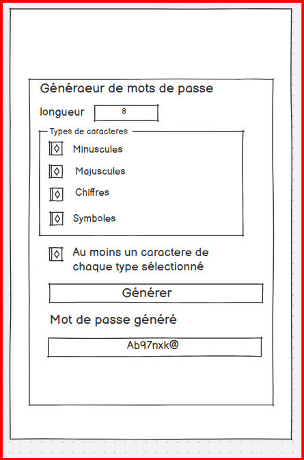
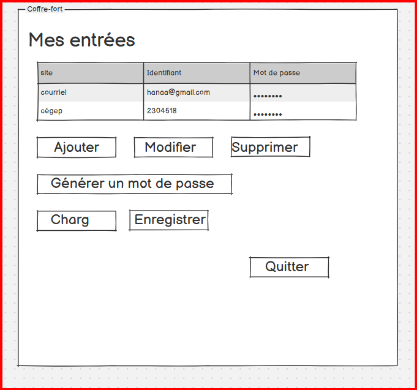

# Gestionnaire de mots de passe

## Informations

- Nom : Hanaa Aquil
- Numéro d’étudiant : 2304518
- GitHub : hanaaaquil-glitch

## Description

Cette application permet de créer des mots de passe.

On peut choisir la longueur et les caractères utilisés.
On peut aussi afficher, masquer et copier le mot de passe.

Le coffre-fort permet d’ajouter, de modifier et de supprimer
des e-mails avec leurs mots de passe.
On peut aussi trier les entrées par e-mail.

Les données sont chargées au démarrage et sauvegardées
à la fermeture dans le fichier vault.json.

## Installation

Il faut avoir Python et uv installés.

## Ouvrir l’application

    uv run main.py

## Utiliser le mode terminal

Créer un mot de passe de 16 caractères :

    uv run main.py --no-gui

Créer un mot de passe sans symboles :

    uv run main.py --no-gui --no-symbols

Les options disponibles sont :

- --length : choisir la longueur.
- --no-lower : sans minuscules.
- --no-upper : sans majuscules.
- --no-digits : sans chiffres.
- --no-symbols : sans symboles.
- --validate : avoir au moins un caractère de chaque type choisi.

Par défaut, le fichier utilisé est vault.json.

## Maquettes

### Générateur de mots de passe

### Coffre-fort

